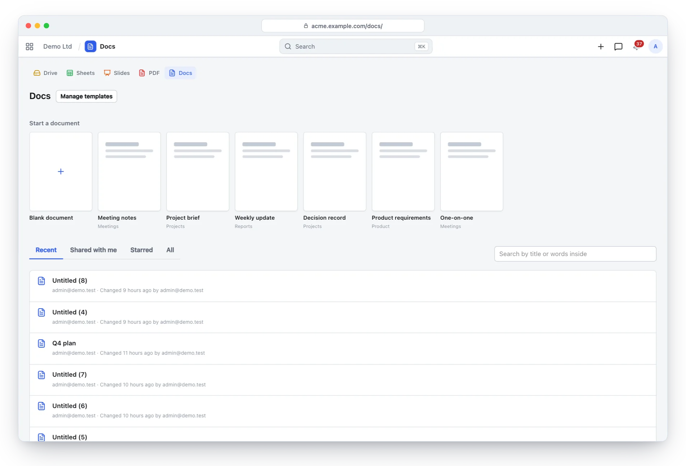
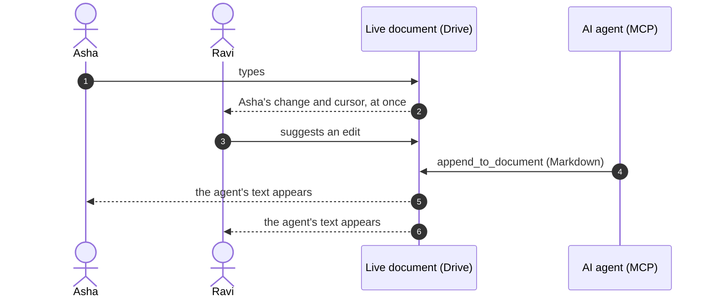
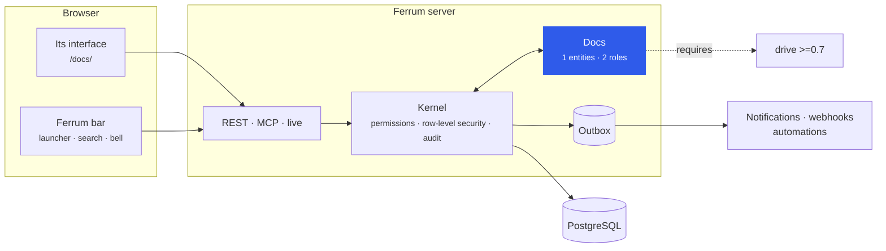
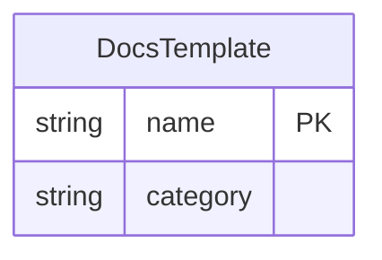

<div align="center">

<picture>
  <source media="(prefers-color-scheme: dark)" srcset="docs/assets/banner-dark.svg">
  
</picture>

[](https://github.com/CBFerrum/ferrum-app-docs/actions/workflows/ci.yml)      

**A native app for [Ferrum](https://github.com/CBFerrum/Ferrum), the open-source, AI-first business platform.**

[Overview](#overview) · [Highlights](#highlights) · [Screenshots](#screenshots) · [How it works](#how-it-works) · [Data model](#data-model) · [Install](#install) · [Develop](#develop) · [Changelog](#changelog)

</div>

---

## Overview

Ferrum Docs is the home for documents written together: recent, shared and starred documents and
folders, each showing who is in it now; templates to start from, or a Word or Markdown file to
import; search by what documents say; and, in the editor, a `/` menu for blocks, `@` mentions of
people and records, contents, find and replace, comments and suggestions on the text, and a version
history you can read. Documents are Drive's live documents, so sharing, versions, trash and guest
links are Drive's, and AI agents draft and add to them over Ferrum's MCP server.


| At a glance | |
|---|---|
| 📦 Version | `0.6.0` |
| 🧱 Platform | Ferrum `>=0.3.2, <0.4` |
| 🔗 Requires | drive `>=0.7` |
| 🖥️ Interface | its own, at `/docs/` |
| 🗃️ Records | 1 entities in 1 package |
| 👥 Roles | 2: Docs User, Docs Manager |
| 📊 Reports | 0 |
| 🧪 Tests | 3 Rust tests, 13 interface test files |


## Highlights

<table>
<tr>
<td width="50%" valign="top">

### 👥 Written together
Everyone's cursors and names, saved as they type.

</td>
<td width="50%" valign="top">

### 🧩 Templates
Meeting notes, project brief, weekly update, decision record, PRD and one-on-one, plus your own.

</td>
</tr>
<tr>
<td width="50%" valign="top">

### 🔎 Search by content
Find documents by what they say, with the words shown in context.

</td>
<td width="50%" valign="top">

### 💬 Comments and suggestions
Discuss and propose changes on the text itself.

</td>
</tr>
<tr>
<td width="50%" valign="top">

### ⌨️ Slash menu and mentions
`/` puts a heading, list, table, callout or picture in the text; `@` names a person (who is told) or a record.

</td>
<td width="50%" valign="top">

### 🕘 Version history
Read any version, see the words that changed, and restore one as a copy.

</td>
</tr>
<tr>
<td width="50%" valign="top">

### 📥 Import and export
Make a document from a Word or Markdown file; download it as Word, PDF, Markdown, text or a web page.

</td>
<td width="50%" valign="top">

### 🗂️ Folders and filters
Browse your folders and your teams', and narrow the list by owner and when it changed.

</td>
</tr>
<tr>
<td width="50%" valign="top">

### 🤖 AI agents
Agents create, read and append in Markdown over MCP; what they add appears live.

</td>
<td width="50%" valign="top">

### 🗂️ Drive underneath
Sharing, versions, trash and guest links come from Drive.

</td>
</tr>
</table>

## Screenshots

<picture>
  <source media="(prefers-color-scheme: dark)" srcset="docs/assets/docs-dark.webp">
  
</picture>

<p align="center"><sub>Docs: templates to start from and recent documents.</sub></p>

> [!TIP]
> The screenshots follow your GitHub theme: switch between light and dark to see both.

## How it works

### Live editing



### Inside Ferrum



Everything Docs adds is ordinary Ferrum metadata and Rust: its records get lists, forms,
search, permissions, an audit trail, exports and the REST and MCP APIs for free, so AI agents work
with them under the same rules as people.

### What it adds to Ferrum

| Where | What |
|---|---|
| 🚀 Launcher | **Docs** at `/docs/` |
| ➕ Create menu | Document |

## Data model

The main records and how they connect (1 entities in all; `packages/` has every field).



### Roles

| Role | What it is for | Entities |
|---|---|---|
| **Docs User** | Writes documents in Docs: a Drive space of their own (as a Drive User has), the documents shared with them, and the workspace's templates to start from. What they may do with each document is Drive's sharing. | 3 |
| **Docs Manager** | Keeps the workspace's document templates, and makes new ones from documents. | 1 |

## Install

Workspace administrators install it from **Apps** (`/store/`) in Ferrum; it ships in the
official Ferrum server image. It needs **drive** `>=0.7` installed first. Self-hosters building their own image enable the
`docs` feature of the server. Everything it adds is also available to AI agents over
Ferrum's MCP server, within each person's permissions.

## Develop

Clone it next to the platform:

```text
work/
├── ferrum/            https://github.com/CBFerrum/Ferrum (with Ferrum-Frontend cloned into ferrum/web)
└── ferrum-app-docs/
```

Point the platform dependencies at your checkout (this file is git-ignored):

```toml
# .cargo/config.toml
[patch."https://github.com/CBFerrum/Ferrum"]
ferrum-apps = { path = "../ferrum/crates/apps" }
ferrum-domain = { path = "../ferrum/crates/domain" }
ferrum-kernel = { path = "../ferrum/crates/kernel" }
ferrum-meta = { path = "../ferrum/crates/meta" }
```

The tests need PostgreSQL with an ordinary (non-superuser) role, so row-level security
applies:

```bash
createuser ferrum --pwprompt && createdb -O ferrum ferrum_docs_test
cargo test
```

`FERRUM_DOCS_TEST_DATABASE_URL` overrides the database URL.


Its tests also build on [ferrum-app-drive](https://github.com/CBFerrum/ferrum-app-drive), which Cargo takes from GitHub.
To work on it alongside this app, clone it into the same folder and add to the same file:

```toml
[patch."https://github.com/CBFerrum/ferrum-app-drive"]
ferrum-app-drive = { path = "../ferrum-app-drive" }
```


The interface lives in `ui/` and builds with Ferrum-Frontend's packages:

```bash
cd ui
npm run build      # ui/dist, checked against the size budget
npm test
```

With a development server started with `FERRUM_DEV_UI=1`, `ferrum-app dev --ui` serves the pages
from Vite behind the real bar and session, with hot reload.


### Project layout

```text
app.yaml      the manifest: id, version, requirements, what it adds to Ferrum
packages/     metadata: entities, roles, reports, workflows, print formats
src/          the app's logic in Rust: hooks, actions, endpoints, upkeep jobs
ui/           its own interface (React + Vite), built into ui/dist
tests/        integration tests against a real PostgreSQL
CHANGELOG.md  what changed in each version
```

## Changelog

| Version | Highlights |
|---|---|
| **0.6.2** | Rebuilt with Ferrum-Frontend daeadda: actions say what they did. |
| **0.6.1** | Rebuilt with Ferrum-Frontend 80ff179: labels name their fields, and linked titles show their titles. |
| **0.6.0** | A `/` menu for blocks and `@` mentions of people and records in the editor; contents from the headings; find and replace; a version history you can read, with the changed words marked; import of Word and Markdown files; and a home with folders, filters and stars. |
| **0.5.2** | Keeping unsaved changes fails safely: a browser that refuses the write at once (as some do when storage is full) no longer counts as having kept … |
| **0.5.1** | When the browser cannot keep unsaved changes (its storage is full, or it refuses IndexedDB), the page says they are kept in this tab only and … |
| **0.5.0** | Suggestions: a mode for editors, Editing or Suggesting. While suggesting, typing proposes: `insertion` and `deletion` marks carry who, when and an … |
| **0.4.0** | Comments on the text: select words and press Comment (Ctrl+Alt+M), with comment access only too. The words are marked and the thread sits beside … |

Every version is in [CHANGELOG.md](CHANGELOG.md).

## License

[AGPL-3.0-only](LICENSE), like the platform. Part of [Ferrum](https://github.com/CBFerrum/Ferrum) ·
[Report an issue](https://github.com/CBFerrum/ferrum-app-docs/issues)
